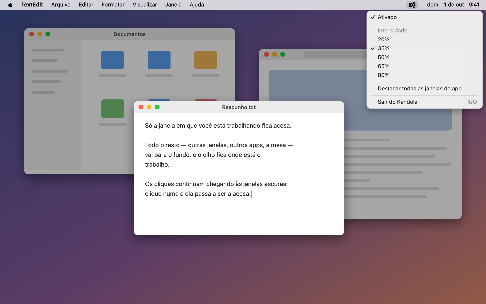

# Kandela

[English](README.md) · **Português**

Escurecedor de distrações local e minimalista para Mac (alternativa livre ao
[HazeOver](https://hazeover.com)): escurece todas as janelas exceto a que está
em foco. Feito em Swift/AppKit puro, ~250 linhas, sem dependências, sem
permissões especiais (não pede Acessibilidade nem Gravação de Tela).



Parte da família de ferramentas da Kogumelo, que têm nome próprio começando
por K (ver também o [Konfig](https://github.com/Kogumelo/konfig)). Chamava-se
`km-dimmer` até 11/10/2026.

## Como funciona

Uma janela preta translúcida por monitor é mantida sempre **logo abaixo** da
janela em foco na pilha global de janelas do macOS (números de janela são
globais, então dá para ordenar relativo a janelas de outros apps). Cliques
atravessam o overlay, e ele não aparece em capturas de tela.

## Compilar e rodar

Precisa do Swift das Xcode Command Line Tools (`xcode-select --install`) e do
macOS 11 ou mais novo.

```sh
./build.sh
open Kandela.app
```

Aparece o K do Kandela na barra de menus com (os nomes seguem o idioma do
sistema; em português):

- **Ativado** — liga/desliga o escurecimento
- **Intensidade** — 20% a 80%
- **Destacar todas as janelas do app** — em vez de só a janela frontal,
  todas as janelas do app em foco ficam claras
- **Sair do Kandela**

As preferências ficam salvas em `defaults` (`br.com.kogut.kandela`). Na
primeira abertura, o Kandela copia as que o `km-dimmer` tinha guardado em
`br.com.kogut.km-dimmer`.

## Ícone

A marca (um K: a haste é uma janela de fundo apagada, com os três pontos do
macOS, e os braços acesos ficam recortados por cima dela) está em
`Assets/kandela-mark.svg`. O ícone da barra de menus é uma versão redesenhada
para 18 pontos (`Assets/kandela-menubar.svg`, com braços cheios e pontos
maiores para ficar nítida), desenhada em código por `kandelaMark()` em
`Sources/main.swift`; o do app fica em `Resources/AppIcon.icns`, gerado por:

```sh
swift Tools/make-icon.swift
```

O ícone colorido do app também existe em SVG, em `Assets/kandela.svg`
(para usar como logo do projeto em outros lugares).

As versões grandes (marca, ícone do app, SVGs) usam a mesma geometria, e a da
barra de menus tem a sua, em `kandelaMark()`, `Assets/kandela-menubar.svg` e
`Tools/make-screenshot.swift`: mudou uma, mude as outras do mesmo grupo.

## Imagem do README

O overlay não aparece em capturas de tela (de propósito), então a imagem do
topo é uma cena desenhada, com a marca e os textos reais do menu, por:

```sh
swift Tools/make-screenshot.swift
```

Ela gera `Assets/screenshot-en.png` e `Assets/screenshot-pt-BR.png`. Se o menu
ou a marca mudarem, rode de novo.

## Traduções

O código está em inglês. Os textos do menu usam o próprio texto em inglês como
chave, e cada idioma tem a sua tradução em
`Resources/<idioma>.lproj/Localizable.strings` (hoje `en` e `pt-BR`). Para
acrescentar um idioma, copie `Resources/en.lproj` para
`Resources/<código>.lproj` e traduza o lado direito de cada linha. O
`./build.sh` recusa compilar se alguma chave do código faltar em algum idioma.

## Iniciar junto com o sistema

Ajustes do Sistema → Geral → Itens de Início e Extensões → "+" → Kandela.app

## Limitações conhecidas (vs. HazeOver pago)

- A troca do escurecimento entre janelas é instantânea (sem fade gradual
  entre janelas — o fade existe só ao ligar/desligar/mudar intensidade).
- Sem intensidade por monitor independente.
- Trocas de foco dentro do mesmo app são detectadas por polling (0,2 s),
  não por evento — imperceptível na prática, CPU ~0%.

## Licença

[MIT](LICENSE) © 2026 Kogumelo Informática Ltda
